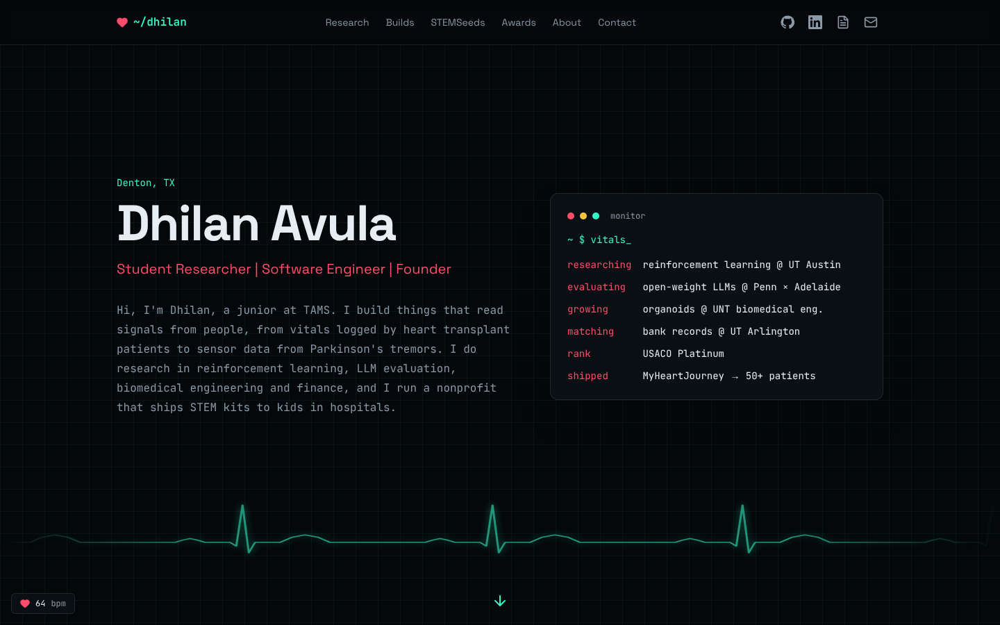
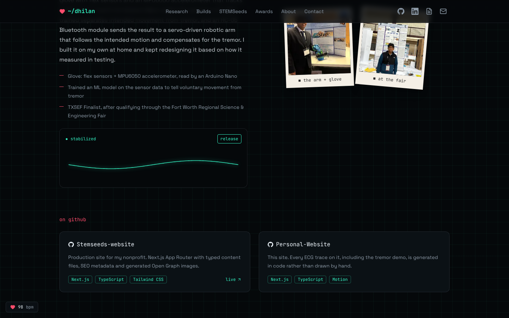

# dhilan's portfolio

My personal site: research, projects, STEMSeeds and awards in one place.

**Live at [dhilanavula.dev](https://dhilanavula.dev)**



## The idea

Most of what I build reads signals from people: vitals logged by heart transplant
patients, sensor data from Parkinson's tremors, cardiovascular risk models. So the
site is themed like a patient monitor: dark screen, faint grid, and a phosphor
heartbeat trace running through it.

- **Hero:** a sweeping ECG line behind a `~ $ vitals` card showing what I'm working on right now.
- **Beat dividers:** between sections, a single heartbeat draws itself as it scrolls into view.
- **Tremor demo:** on the robotic arm project, a shaky red trace smooths into a steady green
  line when you hover or tap "stabilize", which is what the arm does.
- **Flatline footer:** the trace above my email is flat until you reach for the link.
- **BPM readout:** a small heart rate in the corner climbs as you scroll down the page.



## How the traces work

None of the heartbeat lines are images or hand-drawn SVGs. They're generated in
[`lib/ecg.ts`](lib/ecg.ts):

- **`ecgPath`** builds an SVG path from one heartbeat (P wave, QRS spike, T wave)
  defined as points on a 0–1 scale, repeated and stretched to any width.
- **`flatlinePath`** emits the *same* points with the amplitude set to zero.
  Because both paths have the same number of points in the same order, Motion can
  animate one into the other, which is how the footer comes alive.
- **`tremorPath`** does the same trick for the tremor demo: one path with
  high-frequency shake added, and one without, so the line can smoothly settle.
- The tremor noise comes from a small deterministic function instead of
  `Math.random()`, so the server and the browser render the identical path and
  React doesn't report a hydration mismatch.

## Built with

- [Next.js](https://nextjs.org) (App Router), React 19, TypeScript
- [Tailwind CSS](https://tailwindcss.com) v4
- [Motion](https://motion.dev) for the path animations
- Space Grotesk and JetBrains Mono via `next/font`
- Deployed on [Vercel](https://vercel.com); every push to `main` redeploys

The looping CSS animations (the sweeping trace, the stack ticker and the pulsing
heart) switch off under `prefers-reduced-motion`, and the layout is checked down
to phone width.

## Project structure

```
app/
  layout.tsx        fonts and page metadata
  page.tsx          the single page, section by section
  globals.css       monitor color palette and keyframes
components/         one file per section, plus small shared pieces
lib/ecg.ts          heartbeat, flatline and tremor path generators
content/profile.ts  every word on the site
public/images/      project photos
```

## Editing content

All text lives in [`content/profile.ts`](content/profile.ts): research, projects,
experience, awards, courses and links. Components only handle layout, so updating
the site usually means editing that one file.

- **Add a photo:** put it in `public/images/` and add `{ src, caption }` to the
  `photos` list of the project. `position` (CSS `object-position`) nudges the crop
  for portrait shots.

## Run it locally

Needs Node 20 or newer.

```bash
npm install
npm run dev      # http://localhost:3000
npm run build    # production build
npm run lint
```
